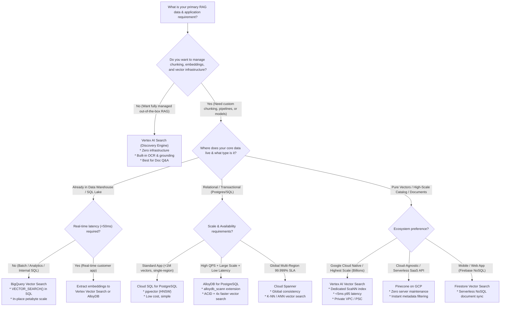
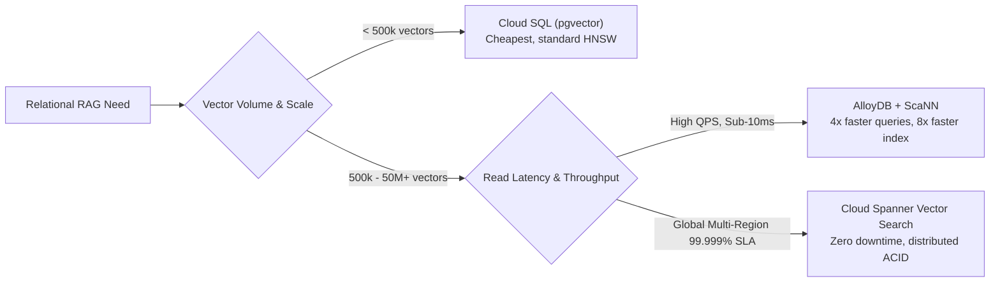

# GCP RAG Database Selection Guide & Architectural Decision Framework
## How to Choose the Right Vector & Storage Backend for Retrieval-Augmented Generation on Google Cloud

---

## 1. Executive Summary & The Core Dilemma

When designing a Retrieval-Augmented Generation (RAG) system on Google Cloud Platform (GCP), one of the most confusing architectural choices is selecting the **database backend**. 

Google Cloud offers multiple databases that support vector embeddings and retrieval:
1. **Vertex AI Search (Discovery Engine)** — Fully managed turnkey search & RAG engine.
2. **Vertex AI Vector Search (formerly Matching Engine)** — Google's high-scale, ultra-low latency ScaNN vector database.
3. **AlloyDB for PostgreSQL** — Enterprise relational database with Google's proprietary `alloydb_scann` vector index.
4. **Cloud SQL for PostgreSQL** — Standard managed PostgreSQL with the open-source `pgvector` extension.
5. **Cloud Spanner** — Globally distributed, horizontally scalable database with built-in K-NN vector search.
6. **BigQuery Vector Search** — Analytical data warehouse with SQL-native vector search (`VECTOR_SEARCH`).
7. **Firestore Vector Search** — Serverless NoSQL document database with vector similarity.
8. **Pinecone on GCP** — Cloud-native dedicated vector database SaaS running natively on Google Cloud.

### Why Are There So Many Options?
There is no single "best" database for RAG. The ideal choice depends on five fundamental trade-off dimensions:
- **Data Shape & Existing Location**: Are your documents already in PostgreSQL, a BigQuery data warehouse, GCS object storage, or Firebase?
- **Relational Joins & ACID Transactions**: Do you need to join vector search results with complex relational tables, user permissions (ACLs), or transactional data?
- **Query Latency (SLA)**: Do you need sub-10ms response times for high-concurrency web apps, or is 300ms acceptable for an internal document assistant?
- **Dataset Scale**: Are you indexing 5,000 internal PDF chunks (<1GB) or 500 million product catalog embeddings (>1TB)?
- **Operational Complexity**: Does your team want zero-ops turnkey simplicity or full control over custom chunking, hybrid search, and re-ranking?

---

## 2. The 30-Second Rule-of-Thumb Cheatsheet

If you need a quick answer, use this decision lookup table:

| If your primary requirement is... | Choose this Database | Why? |
| :--- | :--- | :--- |
| **"I want zero database ops, automated PDF parsing, and out-of-the-box answers with citations"** | **Vertex AI Search** | Complete turnkey SaaS. Handles OCR, parsing, chunking, embedding, indexing, and grounding automatically. |
| **"I need ultra-low latency (<5ms) and have millions or billions of vectors with high QPS"** | **Vertex AI Vector Search** | Built on Google's ScaNN algorithm. Unmatched speed and scale for pure vector similarity search. |
| **"I already use PostgreSQL and need ACID transactions, user ACLs, and blazing-fast vector search"** | **AlloyDB for PostgreSQL** | Combines full PostgreSQL compatibility with Google ScaNN index extension (`alloydb_scann`) for 4x faster queries. |
| **"I have an existing small/medium web app (<1M vectors) and want the lowest cost with standard Postgres"** | **Cloud SQL (pgvector)** | Cost-effective, standard PostgreSQL. Simple `HNSW` / `IVFFlat` indexes without dedicated vector infrastructure. |
| **"I require global multi-region 99.999% SLA, zero planned downtime, and high write concurrency"** | **Cloud Spanner** | True global distributed consistency with built-in vector search for mission-critical enterprise systems. |
| **"My data is already in an enterprise data warehouse and I want to run analytical RAG using SQL"** | **BigQuery Vector Search** | Search petabytes of structured/unstructured data using standard SQL without moving data out of the warehouse. |
| **"I am building a serverless mobile/web app with Firebase and need reactive document sync"** | **Firestore Vector Search** | Native NoSQL document storage with vector search built right into collections and mobile SDKs. |
| **"I want a dedicated, battle-tested, cloud-agnostic vector DB with zero infra setup and great developer DX"** | **Pinecone on GCP** | Serverless vector database with fast API setup, instant metadata filtering, and multi-cloud portability. |

---

## 3. Visual Architectural Decision Trees

### 3.1 Primary Workload Decision Tree



---

### 3.2 Relational & ACID Database Decision Tree

If your application requires relational metadata, user access control lists (ACLs), or transactional integrity, use this sub-tree:



---

## 4. Deep Dive: 8 Real-World Scenario Archetypes

---

### Scenario 1: Enterprise Internal Document Q&A & Policy Bot
* **User Request**: *"We have 20,000 PDF documents (HR handbooks, engineering guidelines, compliance rules) in Cloud Storage. We want employees to ask questions in Slack and get answers with exact page citations."*
* **Recommended Database**: **Vertex AI Search (Discovery Engine)**
* **Why**:
  - You do **not** need to design chunking algorithms, parse complex multi-column tables, or configure embedding models.
  - Vertex AI Search has built-in document parsers (including Document AI integration), automatic hierarchical chunking, extractive segments, and native grounding with Gemini that suppresses hallucinations and includes clickable source URLs.
* **When NOT to use**: If you need to search structured database rows or perform custom vector math with proprietary embedding models.

---

### Scenario 2: High-QPS Semantic E-Commerce Product Finder
* **User Request**: *"Our e-commerce store has 15 million products. We get 2,500 queries per second (QPS) and search results must return in under 10 milliseconds. We also filter by category, brand, and stock status."*
* **Recommended Database**: **Vertex AI Vector Search (formerly Matching Engine)**
* **Why**:
  - Vertex AI Vector Search runs on Google's **ScaNN (Score-Aware Anisotropic Vector Quantization)** algorithm, the same engine that powers Google Search and YouTube.
  - Delivers single-digit millisecond latency (<5ms) at massive concurrency.
  - Supports efficient boolean namespace filtering (e.g., `in_stock = true`, `category = "footwear"`) during the approximate nearest neighbor search (pre-filtering), preventing post-filtering latency spikes.
* **When NOT to use**: If you only have 500 documents and low traffic—the dedicated node cost (`e2-standard-16`) will be needlessly expensive.

---

### Scenario 3: B2B Multi-Tenant SaaS with Strict Row-Level Security & ACLs
* **User Request**: *"We are building a legal document management platform. Each enterprise tenant has their own documents, and individual users have complex permissions (user A can only see documents from department X where status = 'signed')."*
* **Recommended Database**: **AlloyDB for PostgreSQL (`alloydb_scann`)**
* **Why**:
  - Pure vector databases struggle with complex, dynamic permission joins across dozens of relational tables.
  - AlloyDB provides full PostgreSQL ACID compliance, Foreign Keys, and PostgreSQL Row-Level Security (RLS).
  - Google integrated its proprietary ScaNN algorithm directly into AlloyDB as an index operator (`USING alloydb_scann`). It delivers **4x faster query performance** and **8x faster index creation** compared to standard open-source pgvector HNSW on identical hardware.
* **When NOT to use**: If you don't have relational data or SQL needs, or if you need serverless pay-per-query pricing.

---

### Scenario 4: Startup MVP / Cost-Conscious Web Application
* **User Request**: *"We are launching a new startup application. We currently have 50,000 text chunks. We want to spend less than $50/month on database infrastructure while we build traction."*
* **Recommended Database**: **Cloud SQL for PostgreSQL (`pgvector`)**
* **Why**:
  - Can be hosted on a small, shared or single-vCPU Cloud SQL instance (e.g., `db-custom-1-3840` or `db-f1-micro` for staging).
  - Open-source `pgvector` extension supports both `HNSW` (high recall, faster query) and `IVFFlat` (faster build, lower memory).
  - Eliminates the need to pay for a separate vector database while vector counts are under 500,000.
* **When NOT to use**: When your vector count grows beyond 2–3 million items and query throughput increases, HNSW index build times and memory consumption in standard Postgres become a bottleneck.

---

### Scenario 5: Mission-Critical Global Telecom / Banking System
* **User Request**: *"Our customer service RAG assistant operates across North America, Europe, and Asia-Pacific. We cannot tolerate database downtime, replication lag, or data loss. SLA must be 99.999%."*
* **Recommended Database**: **Cloud Spanner Vector Search**
* **Why**:
  - Cloud Spanner provides synchronous global replication with external consistency (TrueTime) and a 99.999% availability SLA.
  - Now supports native vector search directly in SQL statements (`COSINE_DISTANCE`, `EUCLIDEAN_DISTANCE`, `DOT_PRODUCT`).
  - Scales horizontally to thousands of nodes without manual sharding.
* **When NOT to use**: Budget-conscious projects. Cloud Spanner has a higher base entry cost (minimum 100 processing units).

---

### Scenario 6: Petabyte Enterprise Data Warehouse Analytics
* **User Request**: *"Our data lake has 100 million customer service call transcripts, CRM tickets, and survey records stored in BigQuery tables. Our data science team wants to run semantic similarity queries and cluster historical issues using SQL."*
* **Recommended Database**: **BigQuery Vector Search**
* **Why**:
  - No data movement: You do not need to export billions of rows to an external vector database.
  - Generate embeddings directly in BigQuery with `ML.GENERATE_EMBEDDING` using Vertex AI models.
  - Perform vector search using standard SQL: `VECTOR_SEARCH(TABLE customer_tickets, ...)`.
  - Batch indexing with IVF (Inverted File) vector indexes.
* **When NOT to use**: Real-time user-facing chatbots requiring <50ms response times. BigQuery query latency is measured in hundreds of milliseconds to seconds.

---

### Scenario 7: Real-Time Mobile & Web App (Firebase Ecosystem)
* **User Request**: *"We are building a mobile iOS/Android app using Firebase. We want users to search their personal notes, photos, and bookmarks with semantic search."*
* **Recommended Database**: **Firestore Vector Search**
* **Why**:
  - Completely serverless, auto-scaling to zero.
  - Vector similarity search is integrated directly into Firestore document collections using K-Nearest Neighbors (K-NN).
  - Direct integration with Firebase Client SDKs and security rules.
* **When NOT to use**: Complex analytical aggregations or multi-million high-QPS enterprise search.

---

### Scenario 8: Cloud-Agnostic / Fast Prototyping Vector SaaS
* **User Request**: *"Our company runs a multi-cloud architecture (some workloads on AWS, some on GCP). We want a dedicated vector database that developers can spin up in 2 minutes with Python without touching GCP networking."*
* **Recommended Database**: **Pinecone on GCP**
* **Why**:
  - Fully managed SaaS running natively on Google Cloud infrastructure.
  - Excellent developer experience (DX) with official Python, TypeScript, and Go SDKs.
  - True serverless consumption model (pay per read/write unit and storage).
  - Portable across cloud providers if migration is required.
* **When NOT to use**: If corporate security mandates strict private VPC Service Controls (VPC-SC) or zero third-party SaaS data egress.

---

## 5. Comprehensive Technical & Operational Comparison Matrix

| Database Option | Ideal Vector Scale | Query Latency (p95) | Index Algorithm | Hybrid Search (Keyword + Vector) | ACID Transactions | Operational Overhead | Minimum Monthly Cost Baseline |
| :--- | :--- | :--- | :--- | :---: | :---: | :---: | :---: |
| **Vertex AI Search** | Millions of docs | ~100–300 ms | Proprietary Google Search | **Native (Built-in)** | No | **Zero-Ops** (Turnkey) | Pay per query (~$5/1k queries) |
| **Vertex AI Vector Search** | **Billions** of vectors | **< 5 ms** | **ScaNN (Tree-AH)** | Supported (Sparse + Dense) | No | **Medium** (Index + Endpoint) | ~$150–$300 (Dedicated node) |
| **AlloyDB for PostgreSQL** | Tens of Millions | **5–15 ms** | **Google ScaNN** + HNSW | Yes (via PostgreSQL tsvector) | **Full ACID** | **Low-Medium** (Managed DB) | ~$150–$300 (Cluster base) |
| **Cloud SQL (pgvector)** | < 1–2 Million | 20–60 ms | HNSW / IVFFlat | Yes (via PostgreSQL tsvector) | **Full ACID** | **Low** (Managed DB) | ~$15–$50 (Small VM) |
| **Cloud Spanner** | Billions | 10–30 ms | Distributed K-NN / ANN | Yes (via Spanner Full-Text) | **Global ACID (99.999%)**| **Low-Medium** (Managed DB) | ~$65 (100 Processing Units) |
| **BigQuery Vector Search** | **Petabytes / Billions**| 500 ms – 3 s | IVF Index | Yes (via BigQuery Text Search) | Analytics ACID | **Zero-Ops** (Serverless SQL) | Pay per query / GB scanned |
| **Firestore Vector Search** | < 1 Million | 30–80 ms | Flat K-NN | Limited | Document ACID | **Zero-Ops** (Serverless) | Pay per read/write (Free tier) |
| **Pinecone on GCP** | Tens of Millions | 10–30 ms | Proprietary Graph / ANN | Yes (Sparse + Dense) | No | **Zero-Ops** (SaaS) | Pay per read unit ($0 free tier) |

---

## 6. Pricing Models & Hidden Cost Traps

Understanding how each database charges is critical to avoid surprise cloud bills:

```
+─────────────────────────────────────────────────────────────────────────────+
|                        GCP VECTOR DATABASE COST PROFILES                    |
+─────────────────────────────────────────────────────────────────────────────+
|                                                                             |
|  [ALWAYS-ON PROVISIONED]             [SERVERLESS PAY-PER-USE]               |
|  * Vertex AI Vector Search Endpoint   * BigQuery (per TB scanned / query)   |
|  * AlloyDB (Primary Instance)        * Firestore (per read/write)           |
|  * Cloud SQL (Instance size)         * Vertex AI Search (per 1,000 queries) |
|  * Cloud Spanner (Processing Units)  * Pinecone Serverless (per RUs)        |
|                                                                             |
|  Good for: Steady, high-QPS apps.    Good for: Spiky traffic, MVPs, batch   |
|  Trap: Cost incurs even at 0 QPS.    analytics. Trap: Runaway query costs.  |
+─────────────────────────────────────────────────────────────────────────────+
```

### The 4 Major Cost Traps to Avoid
1. **The Vector Search Idle Endpoint Trap**:
   - `google_vertex_ai_index_endpoint_deployed_index` requires dedicated machines (e.g., `e2-standard-16`). Leaving this deployed 24/7 in a development environment will cost ~$200/month even if zero queries are sent.
   - *Mitigation*: For development, undeploy the index when not actively testing, or use Serverless Pinecone / Cloud SQL.
2. **The BigQuery Full Table Scan Trap**:
   - Running `VECTOR_SEARCH()` on a multi-terabyte unindexed table without a `WHERE` partition clause will scan the entire table, racking up query scan costs.
   - *Mitigation*: Always create a vector index (`CREATE VECTOR INDEX`) and partition tables by date.
3. **The AlloyDB Dev Instance Over-Provisioning**:
   - AlloyDB is an enterprise powerhouse, but provisioning a high-spec cluster for a simple prototype will quickly escalate costs.
   - *Mitigation*: Start with Cloud SQL for small prototypes; migrate to AlloyDB when scaling past 1M vectors or needing sub-10ms ScaNN speed.
4. **Vertex AI Search Query Volume at Scale**:
   - Vertex AI Search charges per thousand queries (~$5/1,000 queries for search with extractive answers). If you have millions of queries per month, a dedicated Vector Search or AlloyDB architecture will be substantially cheaper.

---

## 7. Top 5 RAG Database Anti-Patterns (What NOT to Do)

### Anti-Pattern 1: The "Pure Vector Store for Complex Relational Data" Mistake
* **The Mistake**: Storing all enterprise data in a standalone vector database (like Pinecone or pure Vector Search) when the application requires complex joins, transactional updates, and granular user permissions across 30 tables.
* **Why it fails**: You end up writing complex application-level joining code, dealing with eventual consistency bugs, and synchronizing deletions between your primary SQL database and vector store.
* **The Fix**: Use **AlloyDB with `alloydb_scann`** or **Cloud SQL with `pgvector`** to keep relational data and vector embeddings in a single ACID-compliant database.

### Anti-Pattern 2: The "BigQuery for Real-Time End-User Chat" Mistake
* **The Mistake**: Building a customer-facing support chatbot that directly calls BigQuery `VECTOR_SEARCH` on every user keystroke or chat prompt.
* **Why it fails**: BigQuery is an analytical data warehouse. Its cold start and query planner overhead means latency will hover around 1–3 seconds, causing unacceptable UI delay.
* **The Fix**: Use BigQuery to compute batch embeddings and historical analysis; export active search embeddings to **Vertex AI Vector Search** or **Cloud Run + AlloyDB** for serving real-time users.

### Anti-Pattern 3: The "Over-Engineering with AlloyDB for 50 Static Documents" Mistake
* **The Mistake**: Spinning up an AlloyDB cluster, configuring VPC peering, writing custom Python chunking, and managing embedding pipelines just to query 50 company policy PDFs.
* **Why it fails**: Weeks of engineering effort and hundreds of dollars per month wasted on simple document Q&A.
* **The Fix**: Use **Vertex AI Search**. Point it at a GCS bucket with the 50 PDFs and have a working grounded RAG application in 15 minutes.

### Anti-Pattern 4: The "Unfiltered Post-Query" Trap
* **The Mistake**: Asking the vector database for the top 100 nearest neighbors, and *then* filtering out documents in Python based on tenant ID or date.
* **Why it fails**: If only 2 of the top 100 neighbors belong to the requested tenant, your model gets starved of context (low recall).
* **The Fix**: Always use **pre-filtering** using metadata namespaces in Vertex AI Vector Search (`restricts` / `crowding`) or standard SQL `WHERE` clauses in AlloyDB/Cloud SQL.

### Anti-Pattern 5: The "IVFFlat Without Training" Performance Degradation
* **The Mistake**: Using standard `IVFFlat` indexes in PostgreSQL on an empty table and inserting data later without re-indexing.
* **Why it fails**: `IVFFlat` clusters vectors into centroids based on the data present at index creation time. If built on an empty or small table, recall drops catastrophically as new data arrives.
* **The Fix**: Use **HNSW** for streaming data in Cloud SQL, or use **`alloydb_scann`** in AlloyDB which handles dynamic data with high recall.

---

## 8. Summary Decision Matrix & Implementation Roadmap

```
                                  DECISION MATRIX SUMMARY
┌────────────────────────┬──────────────────────┬────────────────────────┬───────────────────────┐
│ Database               │ Primary Persona      │ Killer Feature         │ Terraform Module Path │
├────────────────────────┼──────────────────────┼────────────────────────┼───────────────────────┤
│ Vertex AI Search       │ Rapid Builders       │ Turnkey zero-code RAG  │ modules/discovery-    │
│                        │ & Enterprise Doc Q&A │ with native citations  │ engine                │
├────────────────────────┼──────────────────────┼────────────────────────┼───────────────────────┤
│ Vertex AI Vector Search│ High-Scale Engineers │ <5ms ScaNN at billions │ modules/vector-search │
│                        │ & Core Search Teams  │ of vectors             │                       │
├────────────────────────┼──────────────────────┼────────────────────────┼───────────────────────┤
│ AlloyDB for PostgreSQL │ Full-Stack Devs &    │ ACID SQL joins +       │ modules/alloydb       │
│                        │ SaaS Architects      │ Google ScaNN speed     │                       │
├────────────────────────┼──────────────────────┼────────────────────────┼───────────────────────┤
│ Cloud SQL (pgvector)   │ Startups & MVPs      │ Lowest cost standard   │ modules/cloud-sql-pg  │
│                        │                      │ PostgreSQL             │                       │
├────────────────────────┼──────────────────────┼────────────────────────┼───────────────────────┤
│ Cloud Spanner          │ Mission-Critical     │ Global 99.999% SLA     │ modules/spanner       │
│                        │ Global Enterprise    │ zero-downtime vector   │                       │
├────────────────────────┼──────────────────────┼────────────────────────┼───────────────────────┤
│ BigQuery Vector Search │ Data Engineers &     │ In-place SQL vector    │ modules/bigquery-     │
│                        │ BI / Analytics Teams │ search across PB lakes │ vector                │
├────────────────────────┼──────────────────────┼────────────────────────┼───────────────────────┤
│ Pinecone on GCP        │ Multi-Cloud Teams    │ Zero-ops serverless    │ modules/pinecone      │
│                        │                      │ vector SaaS API        │                       │
└────────────────────────┴──────────────────────┴────────────────────────┴───────────────────────┘
```

---

## 9. Next Steps: Building Your Solution

Every database covered in this guide has a ready-to-deploy, production-tested Terraform module in this repository under:
👉 [`terraform/modules/`](file:///C:/Tiger_AI_infra/terraform/modules/)

For complete end-to-end templates combining storage, database, networking, and serving layers, explore:
- **Serverless Quickstart**: [`terraform/templates/rag-quickstart/`](file:///C:/Tiger_AI_infra/terraform/templates/rag-quickstart/) (Vertex AI RAG Engine + Cloud Run)
- **Enterprise Distributed**: [`terraform/templates/rag-enterprise/`](file:///C:/Tiger_AI_infra/terraform/templates/rag-enterprise/) (Cloud Spanner + Private VPC + Cloud Run)
- **High-Throughput Vector Search**: [`terraform/templates/vector-search-public/`](file:///C:/Tiger_AI_infra/terraform/templates/vector-search-public/) & [`vector-search-private/`](file:///C:/Tiger_AI_infra/terraform/templates/vector-search-private/)
